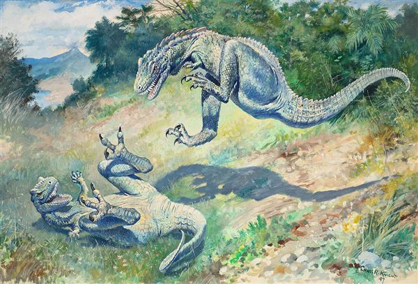

# Links, Pictures, and Broken Code — HTML Debugging Exercise

### 🔗 Live site: **[rickrieger.github.io/links-pictures-and-broken-code](https://rickrieger.github.io/links-pictures-and-broken-code/)**

A bug-hunting exercise from the **Code Immersives** web development bootcamp in New York City (February 2021). The instructor gave us a web page with **5 broken HTML tags** (written wrong, half missing, or the wrong tag entirely), and the job was to find and fix all of them. This repo is my fork of the assignment, with my fixes.

**Skills practiced:** reading HTML for errors, opening and closing tags, `` syntax and `alt` text, relative file paths, and which elements are allowed inside lists.

**Built with:** plain HTML and one CSS rule (`img { height: 100px; }`). No JavaScript.

---

## Contents

- [My solution: the 5 bugs](#my-solution-the-5-bugs)
- [Run it locally](#run-it-locally)
- [Deployment](#deployment)
- [Cleanup log (November 2026)](#cleanup-log-november-2026)
- [Image credits](#image-credits)
- [Original assignment (from the instructor)](#original-assignment-from-the-instructor)

---

## My solution: the 5 bugs

Fixed on **2021-02-10** in two commits ("fixed broken title." and "fixed bugs").

### Bug 1: `<title>` never closed. This one broke the whole page.

The closing tag was missing its `/`, so the browser read it as a *second opening* `<title>`. Everything after it, meaning the entire page, was treated as title text and nothing rendered.

```html
<!-- Before -->
<title>Links, Pictures, And Broken Code<title>

<!-- After -->
<title>Links, Pictures, And Broken Code</title>
```

**Lesson:** closing tags need the `/`. A single missing character in `<head>` can blank the whole page.

### Bug 2: `<h3>` never closed

Without `</h3>`, the paragraphs below were treated as part of the heading, so they showed up big and bold instead of regular size. That's the hint the page gives: "If they're not [regular size], maybe... fix... that?"

```html
<!-- Before -->
<h3> A Sub-Heading
<p>Some regular text that should be regular size.</p>

<!-- After -->
<h3> A Sub-Heading</h3>
<p>Some regular text that should be regular size.</p>
```

### Bug 3: `` tag missing its angle brackets

Without `<` and `>`, the browser doesn't see a tag at all. It printed `img src="https://..." /` on the page as plain text.

```html
<!-- Before -->
img src="https://cdn.history.com/sites/2/2015/07/hith-dinosaur-nesting-site.jpg" /

<!-- After -->

```

I also added `alt` text, which describes the image for screen readers and shows if the image can't load. (The image file itself was replaced during the 2026 cleanup; see [cleanup item 1](#1-fixed-the-missing-dinosaur-image).)

### Bug 4: wrong image path

The photo lives in the `assets/` folder, but the tag looked for it next to `index.html`, so it showed as a broken image.

```html
<!-- Before -->


<!-- After -->

```

**Lesson:** relative paths start from the HTML file's own folder. `./magicians.jpg` means "same folder", and `assets/magicians.jpg` means "inside the assets folder".

### Bug 5: `<p>` inside an ordered list

An `<ol>` (numbered list) may only contain `<li>` items. The `<p>` wasn't numbered, so the list jumped from 1 to 2 with "Under Pressure" sitting unnumbered in between.

```html
<!-- Before -->
<ol>
    <li>One Day More</li>
    <p>Under Pressure</p>
    <li>Don't Get Me Wrong</li>

<!-- After -->
<ol>
    <li>One Day More</li>
    <li>Under Pressure</li>
    <li>Don't Get Me Wrong</li>
```

### Other changes I made at the time

- Added `<meta charset="utf-8">` and a viewport `<meta>` tag so text encodes correctly and the page scales on phones.
- Moved the Magicians photo above its heading.
- Updated the dinosaur list text.

## Run it locally

```bash
git clone https://github.com/RickRieger/links-pictures-and-broken-code.git
cd links-pictures-and-broken-code
# open index.html in a browser
```

## Deployment

Hosted on **GitHub Pages** from the root of the `master` branch (turned on November 2026). Every push to `master` redeploys the page within a minute or two.

---

## Cleanup log (November 2026)

All changes below were made on **2026-11-16** on the branch `cleanup-and-deploy`, checked in a browser, and merged into `master`. Each is its own commit.

### 1. Fixed the missing dinosaur image

**Why:** My 2021 fix pointed the image at `assets/diapsida.jpg`, but that file was never committed to the repo. It only existed on my laptop, so on GitHub (and on any other computer) the "Facts About Dinosaurs" picture was broken, which undid Bug 3. I added a public-domain painting to the repo and pointed the tag at it.

```html
<!-- Before: file doesn't exist in the repo -->


<!-- After -->

```

The new `alt` text describes what's actually in the picture, not just "dinosaurs".

### 2. Resized the Magicians photo (747 KB → 53 KB)

**Why:** `magicians.jpg` was a 2700×1800 photo, but `style.css` displays every image at 100px tall. Visitors downloaded about 750 KB for a thumbnail.

| | Before | After |
|---|---|---|
| Dimensions | 2700 × 1800 | 600 × 400 |
| File size | 747 KB | 53 KB (93% smaller) |

600px wide is still sharp on high-density (retina) screens at the size it's shown.

### 3. Tidied the `<head>`

**Why:** The meta tags I added in 2021 were pasted in with uneven indentation, and two tags shared one line, which made the head hard to read. I also added two standard attributes:

- `lang="en"` on `<html>` tells screen readers and translation tools what language the page is in.
- `initial-scale=1` in the viewport tag is the standard mobile setting, so phones don't zoom out on load.

```html
<!-- Before -->
<html>
    <head>
            <meta charset="utf-8">
    <meta name="viewport" content="width=device-width"><title>Links, Pictures, And Broken Code</title>

<!-- After -->
<html lang="en">
    <head>
        <meta charset="utf-8">
        <meta name="viewport" content="width=device-width, initial-scale=1">
        <title>Links, Pictures, And Broken Code</title>
```

### 4. Deployed to GitHub Pages

**Why:** The page had never been published. It now has a live link (at the top of this README).

### 5. Added this README section

The instructor's original assignment instructions are kept unchanged below.

## Image credits

- `assets/dinosaurs.jpg`: *Leaping Laelaps* by Charles R. Knight (1897), public domain, via [Wikimedia Commons](https://commons.wikimedia.org/wiki/File:Laelaps-Charles_Knight-1897.jpg).
- `assets/magicians.jpg`: provided with the original assignment.

---

## Original assignment (from the instructor)

*The text below is the assignment README as written by the Code Immersives instructor, unchanged.*

### Links, Pictures, and Broken Things

There are 5 tags that are wrong in some way in this page. They're written incorrectly, or only half there, or missing entirely, or just the wrong tag. Let's see if you can fix them!

### "Serving" Your Page

If you don't have the Live Server extension, now is a great time to install it. Once you do have it:

- Click the "Go Live" button in the lower right corner of your Code window. That should open up a browser window with the result of your page.
- Or, better yet, type Command-Shift-P to get your command palette and start typing "live". You should quickly get the command "Live Server - Open With Live Server".
- Or _better_ better yet, memorize the keyboard shortcut it lists next to it!
- Note that this feature is ONLY available if you've opened the whole directory with your editor, the easiest way to do which is `code .`.

Now every time you make changes in your app, VS Code will reload that browser page, showing you the changes.

### So Why Isn't Live Server Serving My Code?

**The top-most bug in this code is producing fully invalid HTML**, breaking the entire page. It's in the `title` tag, and if you don't see it, look at some examples of `title` tag usage online!

Fortunately, once you fix this one, none of the other bugs should give you that issue. They'll only break their own tag, not the whole page. Which is good, because fixing system-breaking bugs like this is awfully hard if nothing tells you where it is!
Note also that very rarely, including the very first bug in the `title` tag, Live Server will not restart itself. For some reason there are some changes it can't handle, including having html in the title tag. But hit "Reload" (Cmd-R) in your browser and you'll be back up and running.

### Good Luck

And happy bug hunting!
